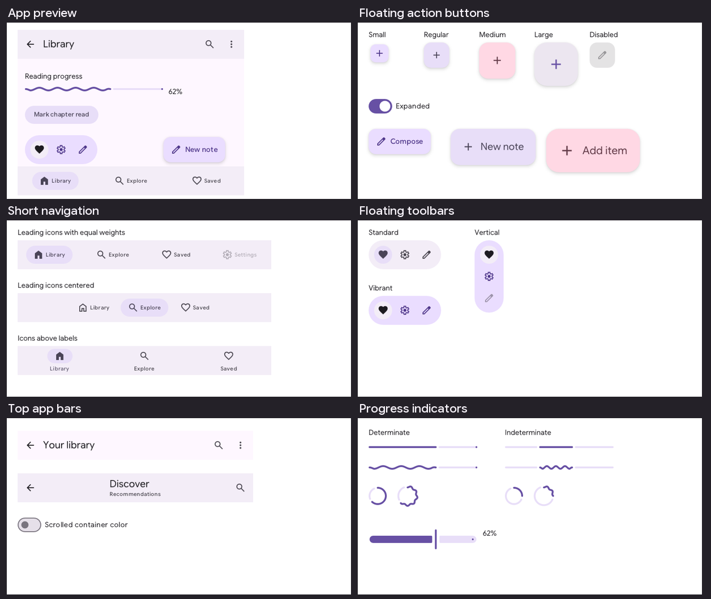

# Material 3 Expressive for Dear ImGui

`m3e-imgui` is a C++17 widget library for applications that already use Dear ImGui. It draws through `ImDrawList`, uses your existing context and renderer backend, and leaves values and application state in your code.

[Download the Windows demo](https://github.com/lithium1on/m3e-imgui/releases/tag/v0.1.0) · [Integration guide](docs/INTEGRATION.md) · [Component catalog](docs/CATALOG.md)

[](docs/ANDROID.md)

## What’s included

- Buttons, icon buttons, connected and segmented groups, tabs, menus, text fields, switches, checkboxes, sliders, dialogs, and tooltips.
- Chips, autocomplete, search, date and time pickers, cards, lists, carousels, sheets, snackbars, navigation rails, split panes, and 35 expressive shapes.
- Android-style floating action buttons, app bars, navigation bars, floating toolbars, wavy progress, and screen layout helpers.
- Light and dark palettes, density and DPI scaling, reduced motion, and ImGui keyboard and gamepad navigation. Roboto, Google Sans Flex, and Material Symbols are bundled with their licenses.

The reference is Matraic M3E Web Components 2.13.5, with Android-style widgets based on Jetpack Compose Material 3. This is an independent port. The comparison notes document differences in geometry, motion, and platform behavior. [Browser comparison notes](docs/PARITY.md) · [Android phone comparisons](docs/ANDROID.md) · [Revisions and licenses](docs/UPSTREAM.md)

## Try the Windows gallery

Download the x64 ZIP from the release above, extract it, and run `m3e_gallery.exe` with the bundled `fonts` folder beside it. The sidebar opens each component. The top controls switch themes, density, and motion settings.

To build it yourself, install CMake 3.20 or newer, Git, and a C++17 toolchain. The Win32/DX11 gallery also needs the Windows SDK. With a multi-configuration generator such as Visual Studio, run these commands from the repository root.

```powershell
cmake -S . -B build -DM3E_BUILD_TESTS=ON
cmake --build build --config Release
ctest --test-dir build -C Release --output-on-failure
.\build\Release\m3e_gallery.exe
```

With a single-configuration generator, set `-DCMAKE_BUILD_TYPE=Release` at configure time. The executables will be under `build/`. On other platforms, build the renderer-independent library and smoke example with `-DM3E_BUILD_GALLERY=OFF`.

## Use it in your application

Dear ImGui **1.92.5** is pinned because the library has a small adapter for ImGui’s internal item and navigation APIs. CMake fetches the pinned source by default. If your application already declares an ImGui target, pass its name to `M3E_IMGUI_TARGET` so the two libraries share the same ImGui instance.

```cmake
# The imgui target must already exist at this point.
set(M3E_IMGUI_TARGET imgui CACHE STRING "")
set(M3E_BUILD_GALLERY OFF CACHE BOOL "")
set(M3E_BUILD_EXAMPLE OFF CACHE BOOL "")
add_subdirectory(external/m3e-imgui)
target_link_libraries(my_app PRIVATE m3e::imgui)
```

You can also point `M3E_IMGUI_SOURCE_DIR` to a compatible local checkout. Call `m3e::LoadFonts` with your context current and before the atlas is locked for a frame. Pass an application-resolved path to the bundled fonts.

```cpp
#include <m3e/imgui.hpp>

// Initialize once, after creating your ImGui context.
m3e::Style material;
material.fonts = m3e::LoadFonts("assets/fonts", m3e::Typeface::GoogleSansFlex);
bool notifications = true;

// Submit inside your ImGui window each frame.
m3e::Switch(material, "Notifications", notifications);

m3e::ButtonOptions save;
save.variant = m3e::Variant::Filled;
save.icon = m3e::icons::Check;
if (m3e::Button(material, "Save", save))
    SavePreferences(notifications);
```

Use `<m3e/components.hpp>` for the expanded catalog and `<m3e/android.hpp>` for the Android reference palette, app bar, navigation, FABs, toolbar, and progress widgets. See the [minimal C++ example](examples/minimal.cpp) and [integration guide](docs/INTEGRATION.md) for context, backend, DPI, and overlay setup.

## License

Project code is available under the [MIT License](LICENSE). The [third-party notices](docs/UPSTREAM.md) identify the original sources, pinned revisions, and terms for the redistributed fonts and other assets.
